<p align="center">
  
</p>

<h1 align="center">Isola</h1>

<p align="center"><b>Живой остров для Windows.</b><br>Музыка, таймеры, уведомления и десятки мелочей в одной капсуле у верхнего края экрана.</p>

<p align="center">
  <a href="https://github.com/rMyst/isola/releases/latest"></a>
  
  
  
</p>

<p align="center">
  <a href="https://github.com/rMyst/isola/releases/latest"><b>Скачать</b></a> ·
  <a href="https://isolo.pro">isolo.pro</a> ·
  <a href="https://t.me/isolapp">Telegram</a> ·
  <a href="CHANGELOG.md">Что нового</a>
</p>

<p align="center">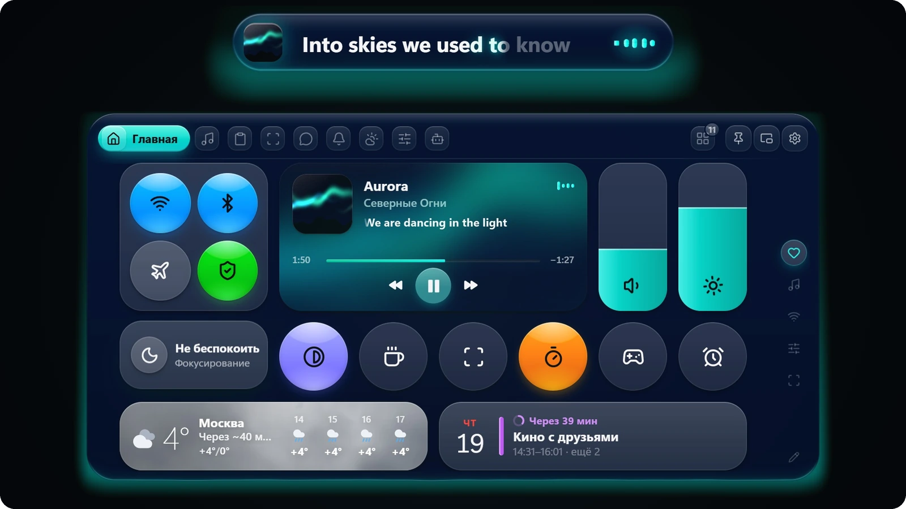</p>

Isola живёт у верхнего края экрана маленькой чёрной пилюлей. Пока ничего не происходит, она почти незаметна. Заиграла музыка, сработал таймер, пришло сообщение: пилюля растягивается и показывает главное. Наведи курсор, и остров раскроется в панель с вкладками: музыка с караоке по словам, пункт управления, буфер обмена, календарь, полка для файлов и многое другое.

Isola бесплатная целиком: без подписок, пробных периодов и платных функций.

<details>
<summary><b>English</b></summary>

<br>

**Isola** is a free "Dynamic Island" for Windows 10 and 11. A small black pill sits at the top edge of the screen and comes alive when something happens: the current song with a live lyric line, timers, notifications (with a button that jumps to the chat), downloads, screen recording and more. Hover it (or press <kbd>Ctrl</kbd>+<kbd>Alt</kbd>+<kbd>Space</kbd>) and it opens into a panel: an iPhone-style Home grid, a control center, a music player with word-by-word karaoke and line translation, clipboard history (optionally on <kbd>Win</kbd>+<kbd>V</kbd>), a calendar, a file shelf, a launcher, screenshot and OCR tools, optional AI with your own key, 12 animated residents and 6 island styles.

The interface is in Russian only. No telemetry. Everything Isola sends over the network is listed in the [privacy section](#приватность) below. Download the installer from [Releases](https://github.com/rMyst/isola/releases/latest).

</details>

<br>

## Остров

Остров открывается **наведением** (с небольшой задержкой, её можно поменять) или **по клику**: это выбор в _Настройки → Поведение → «Открывать остров»_. С клавиатуры: <kbd>Ctrl</kbd>+<kbd>Alt</kbd>+<kbd>Space</kbd>. На самой пилюле работают жесты: свайп влево или вправо переключает трек, если пилюлю потянуть вниз, остров откроется, а долгое нажатие открывает быстрое меню.

Остров может жить на основном мониторе, там, где курсор, или там, где активное окно. Есть размер, материал (_Чёрный_ или _Стекло_), отступ от края, тёмная, светлая и автоматическая тема, акцент своего цвета, по обложке или по обоям.

<p align="center">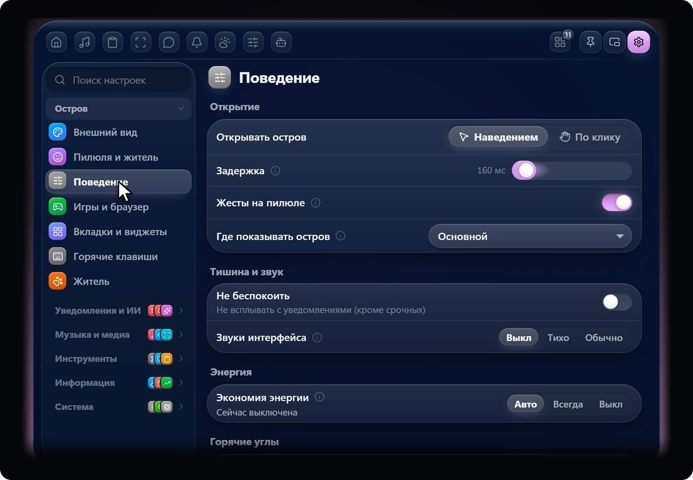</p>

## Живая пилюля

В пилюле всегда то, что идёт прямо сейчас: трек с обложкой и эквалайзером или с текущей строкой песни, таймер, секундомер, фокус-сессия, запись экрана, загрузка файла или игры в Steam, голосовой канал Discord, тест скорости, «Что играет?». Если дел два, второе висит рядом маленьким пузырьком. События вроде сообщения, нового трека или подключённых наушников приходят короткой карточкой и уходят сами.

В покое справа в пилюле до четырёх показателей на выбор: часы, погода, ближайшее событие, курсы валют, заряд батареи и аксессуаров, загрузка процессора, скорость сети и другие. Свечение вокруг острова и «жидкость», которая тянется к курсору, настраиваются в _Настройки → Пилюля и житель_.

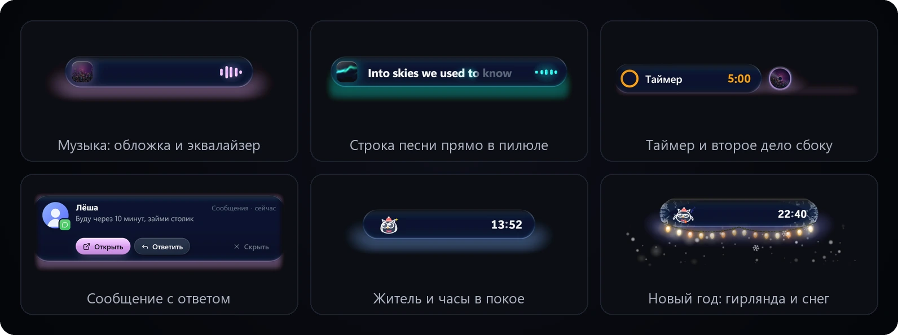

## Жители и стили

Рядом с часами живёт **житель**: маленький персонаж, который моргает, следит за курсором, засыпает, когда ты отошёл, и реагирует на события. Их двенадцать. Житель может стать питомцем: его можно кормить, наряжать и растить от малыша до взрослого.

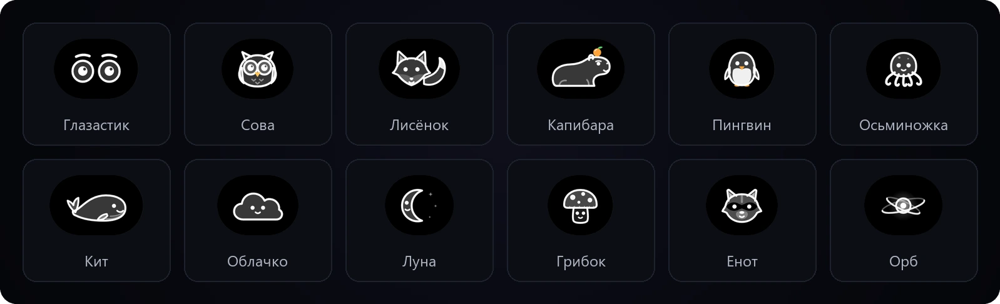

**Шесть стилей острова** меняют не только цвет, но и характер: _Айфон_ (капсула под краем экрана), _Мак_ (чёлка, приклеенная к краю), _Android_ (сверху или снизу), _Windows 11_, _Хайпрленд_ (блоки и градиентная рамка) и _Бумага_ (плоско, контрастно, жёсткая тень). Меню острова подстраивается под выбранный стиль.

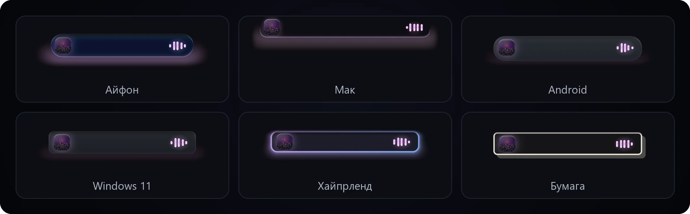

## Главная

Первая вкладка устроена как экран айфона: сетка 8 × 4, плитки ставятся в любую клетку, пустые места можно оставлять. Плитки меняются местами перетаскиванием, размер тянется за уголок, страниц может быть несколько. В «Добавить элемент» видно живое превью плитки в настоящем размере. Здесь живут Wi‑Fi и Bluetooth, «Сейчас играет» в четырёх размерах, громкость и яркость, погода, календарь, таймер, таймер сна, «Не беспокоить» и другие кнопки.

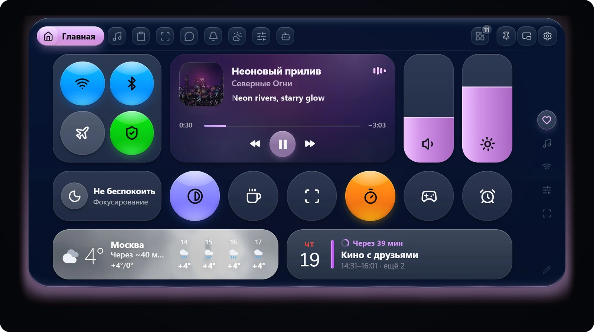

## Управление

Пункт управления в духе iPhone: крупные круглые и вытянутые кнопки, высокие ползунки яркости и громкости. Wi‑Fi, Bluetooth и Питание показывают сети, устройства и заряд прямо на плитке, а долгое нажатие раскрывает подробную карточку. Здесь же «Не беспокоить», ночной свет, тема Windows, «не засыпать», игровой режим, блокировка, запись и снимок экрана, таймер, вывод звука, микрофон и VPN.

<p align="center">
  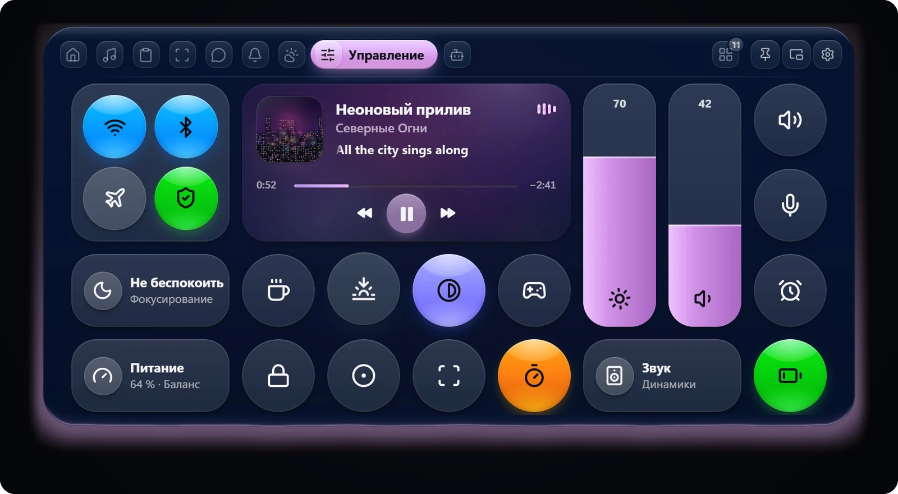
  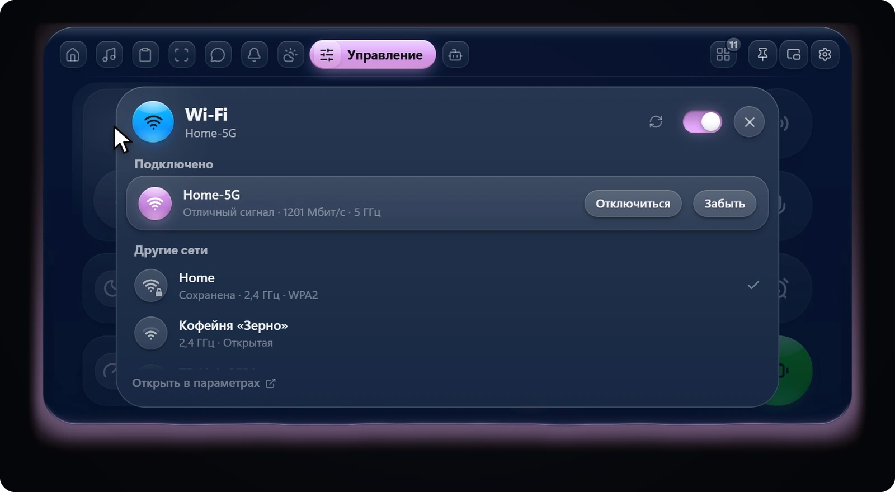
</p>

## Музыка

Isola видит любой плеер, который показывает себя в системном медиа-окне Windows: обложка, управление, перемотка, выбор устройства вывода. Цвет плеера берётся из обложки, при смене трека обложка уходит колодой.

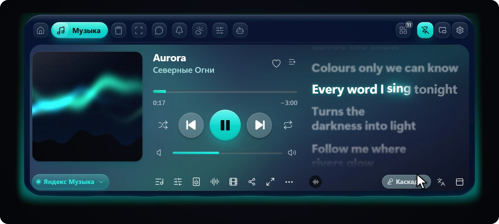

**Тексты песен** ищутся сами в нескольких источниках: LRCLIB, NetEase, Musixmatch, Genius и Яндекс Музыка (с твоим токеном). Побеждает первый, у кого есть синхронный текст, а выбор запоминается для каждого трека. Если текст спешит или опаздывает, его можно сдвинуть.

**Караоке по словам.** Текущая строка подсвечивается слово за словом прямо в пилюле, в плеере и на весь экран. Для точной подсветки есть модель распознавания речи (GigaAM, около 150 МБ), она скачивается отдельно по кнопке в _Настройки → Музыка → Тексты песен_ и работает на компьютере без интернета: Isola слушает звук плеера и отмечает, когда спето каждое слово. В первый раз строка только подстраивается под голос, а найденные слова запоминаются, и при следующем прослушивании идут точно. Через общий кэш слова, найденные у других, приходят сразу (что именно уходит, написано в [приватности](#приватность)).

**Перевод строк** показывает перевод под каждой строкой. Долгое нажатие на строку объясняет её смысл через ИИ, если он подключён.

<p align="center">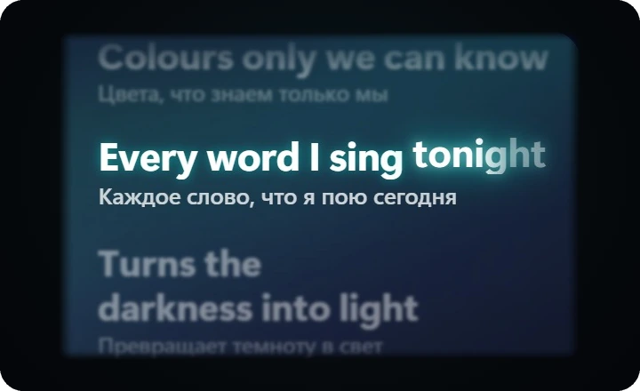</p>

**Плеер при наведении.** Пока играет музыка, наведение на остров открывает маленький плеер с крупной строкой текста. Есть и **мини-плеер**: отдельная маленькая карточка поверх окон, которую можно утащить куда угодно. **Караоке на весь экран** умеет 9 стилей: Каскад, Свечение, По буквам, Всплытие, Волна, Терминал, Эхо, Постер и Эдит.

<p align="center">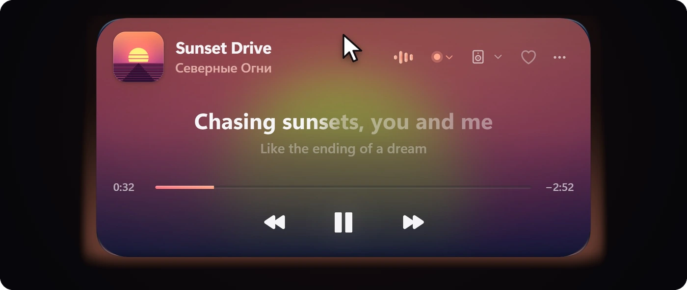</p>

**Браузер и Яндекс Музыка.** Расширение **Isola Bridge** для Chrome, Edge и Яндекс Браузера подключает Яндекс Музыку, Spotify, YouTube Music и SoundCloud во вкладке: лайк, повтор, перемешивание и «Моя волна» срабатывают в фоне, а караоке идёт по часам самой страницы. Ставится из _Настройки → Музыка_ через «Загрузить распакованное» на странице расширений. Для настольной Яндекс Музыки есть отдельная **интеграция** по кнопке: Isola встраивает в приложение небольшой модуль, и «Моя волна», лайк, повтор и перемешивание работают прямо в нём. Она меняет два файла приложения, копия оригиналов хранится у Isola, а выключение возвращает файлы как были.

Ещё в музыке: «Неделя в музыке», плитка «Цитата дня», «Дальше: …» перед концом трека (очередь Яндекс Музыки, нужен токен), мат звёздочками, статус «Слушает» в Discord (выключен по умолчанию).

### Клипы для TikTok и YouTube

Из любого трека с текстом получается видео: 9:16, 1:1 или 16:9 Full HD, с припева, с нужного места или своим отрезком. Шаблоны: Караоке, Эхо, Постер, Эдит (5 пресетов и тонкая настройка), Обложка и Остров. Фон: обложка, свой файл, поиск фото и видео или Pinterest, с затемнением и размытием. На Windows 11 в клип пишется звук только из плеера, без уведомлений и игр. В углу клипа всегда стоит небольшой знак: мини-остров и isolo.pro.

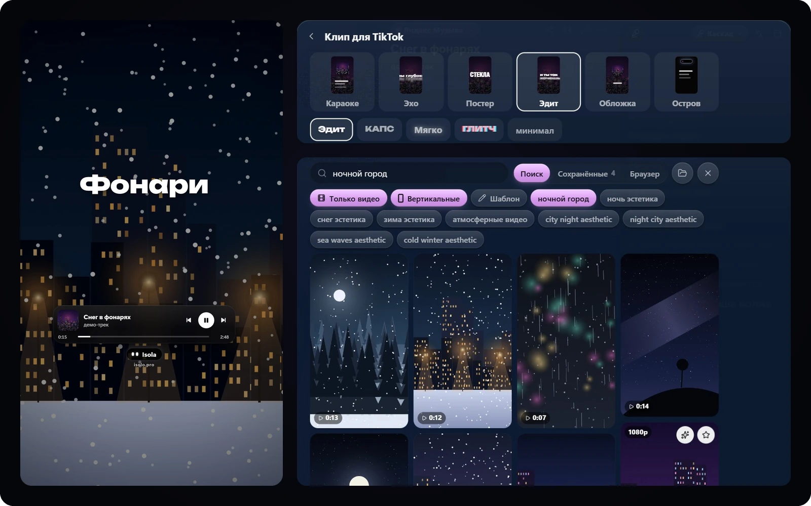

## Буфер обмена

История буфера по дням, с поиском, фильтрами и превью по типу. Ссылку можно открыть, очистить от трекеров или превратить в QR-код, цвет показывается в HEX, RGB, HSL и OKLCH, у картинки распознаётся текст. Несколько записей можно выделить и склеить в одну, нужные закрепить. Открывается вкладкой или по <kbd>Ctrl</kbd>+<kbd>Alt</kbd>+<kbd>V</kbd>.

По желанию буфер Isola открывается **по <kbd>Win</kbd>+<kbd>V</kbd>** отдельным окном у курсора вместо стандартного (_Настройки → Буфер обмена → «Открывать по Win+V вместо буфера Windows»_). Всё с клавиатуры: печатаешь для поиска, стрелки, <kbd>Enter</kbd> вставляет в программу, где ты был, <kbd>Shift</kbd>+<kbd>Enter</kbd> вставляет без форматирования.

<p align="center">
  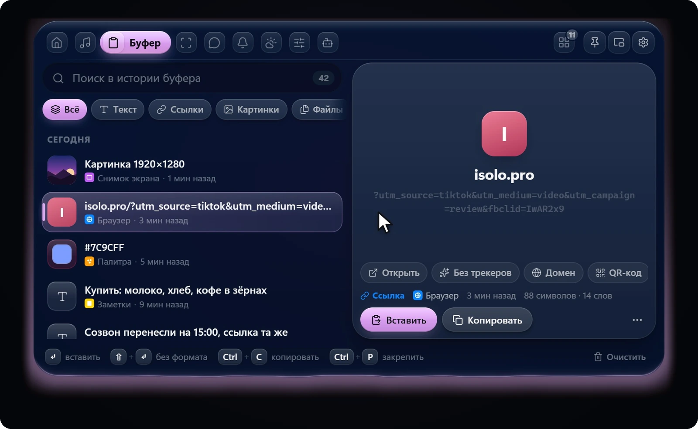
  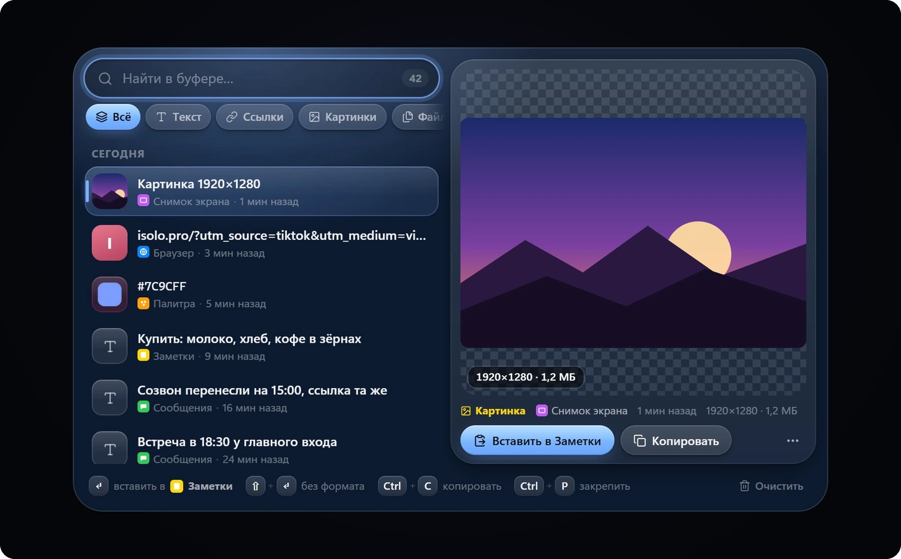
</p>

## Календарь

Месяц, день по часам с красной линией «сейчас» и список на 10 дней. События приходят из твоих iCal-подписок (ссылка из любого календаря) и из своих событий Isola. За пару минут до созвона на пилюле появляется кнопка «Войти». Внизу мировые часы с циферблатом: днём светлые, ночью тёмные.

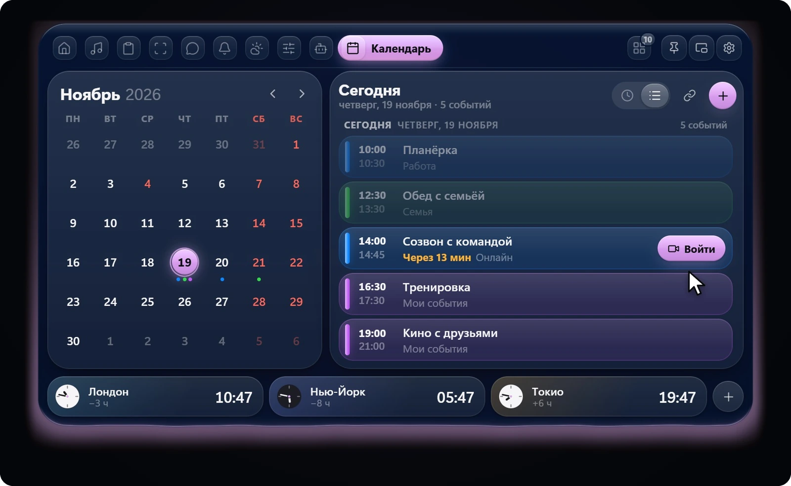

## Полка

Кинь файл на остров, и он ляжет на полку. Внутри полки файлы переставляются перетаскиванием, а если увести файл за край, он уходит в любую программу. Есть сортировка, группы по типу, закрепление, переименование по <kbd>F2</kbd> и «Вернуть» после удаления (или <kbd>Ctrl</kbd>+<kbd>Z</kbd>).

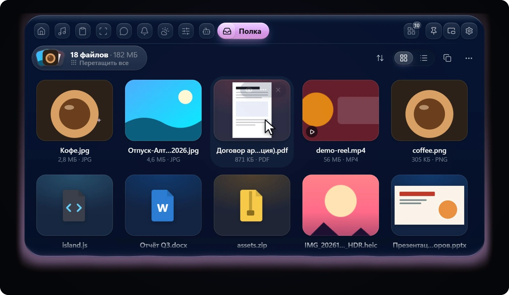

## Игры и браузер

**В играх** и полноэкранных приложениях остров по умолчанию прячется и копит уведомления на потом. Вместо этого можно оставить мини-пилюлю с FPS, пингом, загрузкой процессора и видеокарты или показывать остров как обычно. Игры узнаются сами, а если какая-то не узнаётся, её можно отметить вручную. <kbd>Ctrl</kbd>+<kbd>Alt</kbd>+<kbd>G</kbd> включает игровой режим руками.

**Над браузером** остров может вести себя как обычно, уменьшаться до полоски или маленькой пилюли или раздвигать вкладки, чтобы ничего не закрывать. Можно открывать его там только по клику и добавить свои программы (Office уже в списке).

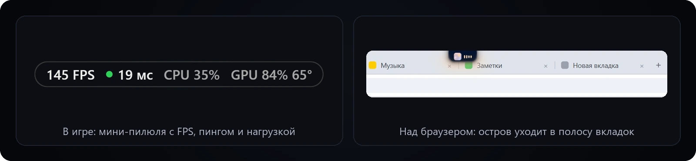

## Лаунчер

<kbd>Alt</kbd>+<kbd>Space</kbd> открывает строку поиска: приложения, файлы (`f`), открытые окна (`w`), калькулятор, конвертер единиц и валют, даты, цвета, эмодзи (`:`), сниппеты (`;`), завершение процесса (`kill`), быстрые ссылки и поиск в интернете по префиксам (`g`, `я`, `yt`, `gh`, `wiki`). Модули добавляют свои команды: напоминания и таймеры («через 30 минут», «таймер 10 мин»), погода, курс, перевод, StandBy, житель.

## Снимки экрана, текст и запись

Скриншот области или всего экрана, текст с экрана (распознаётся встроенным OCR Windows, без интернета), QR-код с экрана, пипетка, запись экрана с паузой, картинка поверх окон. Распознанный текст можно сразу исправить или перевести. «Последние 30 секунд» игры сохраняются по <kbd>Ctrl</kbd>+<kbd>Alt</kbd>+<kbd>X</kbd> через буфер повтора OBS или фоновую запись Xbox Game Bar. Снимки лежат в «Изображения\Isola», записи в «Видео\Isola».

## ИИ со своим ключом

ИИ в Isola необязателен и работает только с тем, что ты подключишь: свой ключ Anthropic, OpenAI, Google Gemini, DeepSeek, OpenRouter, Groq, Mistral или xAI, локальные Ollama и LM Studio, установленный Codex CLI или свой сервер. Что умеет:

- чат во вкладке, с файлами (текст из PDF и документов Office достаётся на компьютере);
- вопрос о выделенном тексте (<kbd>Ctrl</kbd>+<kbd>Alt</kbd>+<kbd>J</kbd>) и перевод выделенного;
- «Объясни, что на экране» (<kbd>Ctrl</kbd>+<kbd>Alt</kbd>+<kbd>E</kbd>): снимок уходит выбранному провайдеру, перед первым разом Isola спрашивает;
- голосовой ввод (<kbd>Ctrl</kbd>+<kbd>Alt</kbd>+<kbd>M</kbd>) через OpenAI, Groq, свой сервер или встроенный диктант Windows;
- перевод и объяснение строк песен.

Для перевода без ключа есть бесплатный переводчик. Ключи хранятся зашифрованными средствами Windows.

## И ещё

- **ИИ-агенты для кода** (Claude Code и Codex): что агент делает сейчас, запросы разрешений и вопросы прямо на острове, отвечать можно оттуда же.
- **Уведомления Windows** на острове, по отправителям и с историей, а «Ответить» сразу открывает нужный чат. Их можно показывать только в Isola.
- **Discord**: кто говорит в голосовом канале, кнопки микрофона и звука.
- **Погода** с прогнозом и предупреждением о дожде, **StandBy** (часы на весь экран), **фокус-сессии**, **заметки** и **напоминания** («завтра в 9», «через 30 минут»), **таймер сна**.
- **Обзор окон** (<kbd>Ctrl</kbd>+<kbd>Alt</kbd>+<kbd>W</kbd>), зоны раскладки и пространства окон.
- **Сценарии** «Когда → Если → Сделать» со своими сочетаниями клавиш.
- **Сеть**: тест скорости, пинг до серверов, подсказка, почему пропал интернет, внешний IP и страна.
- **Загрузки Steam**, папка «Загрузки», батареи Bluetooth-устройств и геймпада, флешки, раскладка.
- **Локальный API и командная строка**: свои скрипты и сборки показывают прогресс на острове. Подробнее в [API.md](API.md).

## Вид и анимации

Три облика интерфейса: **Сочный** (глянец, глубина и цвет обложки), **Обычный** и **Минимализм** (плоско, тонкие линии, без эффектов). Анимации: _Авто (по виду)_, _Спокойно_, _Обычно_ и _На максимум_. На «Спокойно» всё тихо и дёшево для слабых компьютеров, на «Максимуме» пружины, перелёты между экранами и волна плиток. Плотность интерфейса и размер текста тоже настраиваются.

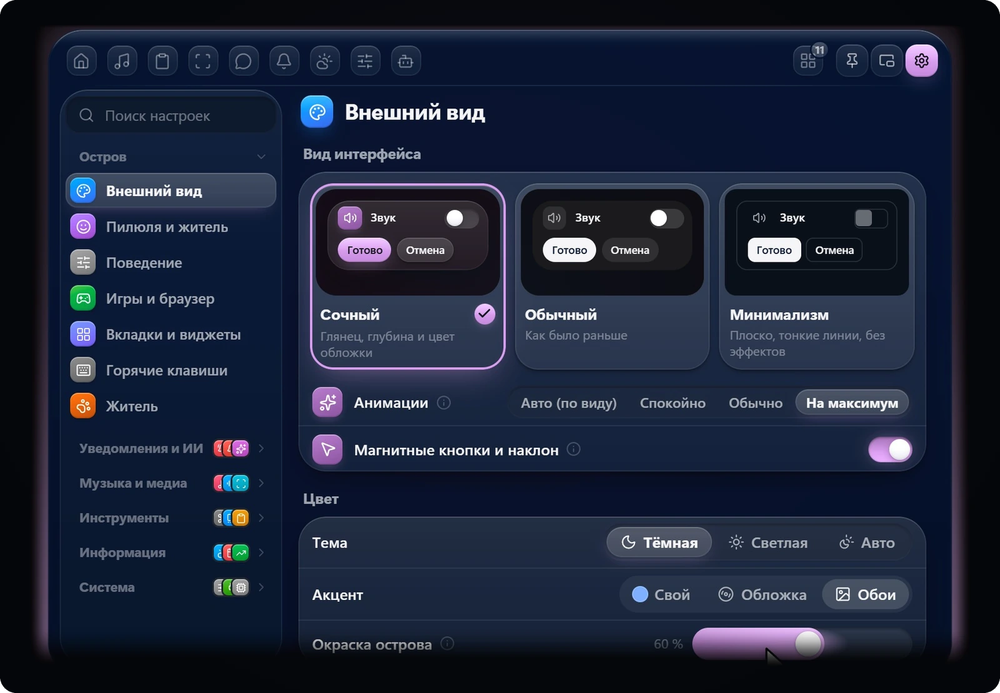

**Горячие углы**: задержи курсор в углу экрана на четверть секунды, и откроется обзор окон, рабочий стол, лаунчер или центр управления. В играх, видео и презентациях на весь экран углы молчат.

<p align="center">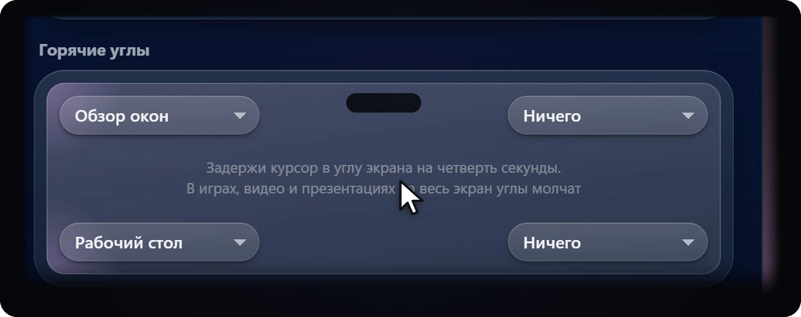</p>

**Новый год** включается сам 1 декабря: гирлянда под каждый стиль, снегопад, шапка снега на острове, житель в новогодней шапке. 31 декабря на острове идёт обратный отсчёт, а в полночь из острова вылетает салют. Посмотреть заранее: _Настройки → Пилюля и житель → Новый год → «Посмотреть»_.

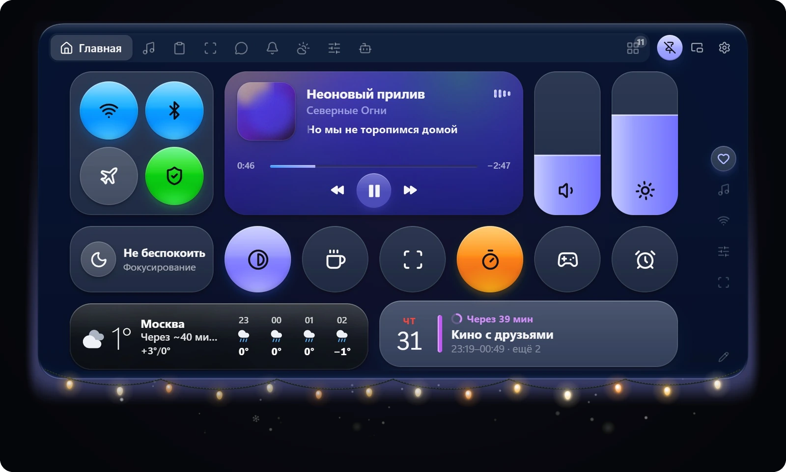

## Настройки

Все настройки разложены по разделам, поиск находит любую строку, а длинные пояснения открываются по ⓘ. В разделе **Система**:

- **«Память»** показывает, сколько занимает Isola целиком, вместе со своими процессами WebView2 (в диспетчере задач они идут отдельно, как «Microsoft Edge WebView2»);
- **«Сообщить о проблеме»** открывает бота поддержки [@Isolappbot](https://t.me/Isolappbot) в Telegram. Сама Isola при этом ничего не отправляет;
- папка с данными, журнал и адрес с токеном для локального API.

## Горячие клавиши

На новой установке сразу работает только <kbd>Ctrl</kbd>+<kbd>Alt</kbd>+<kbd>Space</kbd>. Остальные сочетания из таблицы Isola предлагает в _Настройки → Горячие клавиши_: одно нажатие, и сочетание назначено. Так они не мешают раскладкам, где <kbd>Ctrl</kbd>+<kbd>Alt</kbd> работает как <kbd>AltGr</kbd>, и системному <kbd>Alt</kbd>+<kbd>Space</kbd>. У тех, кто обновился со старых версий, всё осталось как было. Любое сочетание можно поменять или убрать.

| Сочетание | Что делает |
|---|---|
| <kbd>Ctrl</kbd>+<kbd>Alt</kbd>+<kbd>Space</kbd> | открыть или закрыть остров |
| <kbd>Ctrl</kbd>+<kbd>Alt</kbd>+<kbd>H</kbd> | спрятать или показать остров |
| <kbd>Alt</kbd>+<kbd>Space</kbd> | лаунчер |
| <kbd>Ctrl</kbd>+<kbd>Alt</kbd>+<kbd>G</kbd> | игровой режим |
| <kbd>Ctrl</kbd>+<kbd>Alt</kbd>+<kbd>P</kbd> | в играх: прятать, мини-пилюля или показывать |
| <kbd>Ctrl</kbd>+<kbd>Alt</kbd>+<kbd>A</kbd> | скриншот области |
| <kbd>Ctrl</kbd>+<kbd>Alt</kbd>+<kbd>S</kbd> | скриншот всего экрана |
| <kbd>Ctrl</kbd>+<kbd>Alt</kbd>+<kbd>T</kbd> | текст с экрана |
| <kbd>Ctrl</kbd>+<kbd>Alt</kbd>+<kbd>Q</kbd> | QR-код с экрана |
| <kbd>Ctrl</kbd>+<kbd>Alt</kbd>+<kbd>C</kbd> | пипетка |
| <kbd>Ctrl</kbd>+<kbd>Alt</kbd>+<kbd>R</kbd> | запись экрана: старт и стоп |
| <kbd>Ctrl</kbd>+<kbd>Alt</kbd>+<kbd>X</kbd> | сохранить последние 30 секунд игры |
| <kbd>Ctrl</kbd>+<kbd>Alt</kbd>+<kbd>V</kbd> | история буфера обмена |
| <kbd>Win</kbd>+<kbd>V</kbd> | буфер Isola отдельным окном (если включено в настройках буфера) |
| <kbd>Ctrl</kbd>+<kbd>Alt</kbd>+<kbd>N</kbd> | быстрая заметка |
| <kbd>Ctrl</kbd>+<kbd>Alt</kbd>+<kbd>J</kbd> | ИИ: спросить о выделенном |
| <kbd>Ctrl</kbd>+<kbd>Alt</kbd>+<kbd>E</kbd> | ИИ: объясни, что на экране |
| <kbd>Ctrl</kbd>+<kbd>Alt</kbd>+<kbd>M</kbd> | голосовой ввод |
| <kbd>Ctrl</kbd>+<kbd>Alt</kbd>+<kbd>F</kbd> | «Что играет?»: узнать песню |
| <kbd>Ctrl</kbd>+<kbd>Alt</kbd>+<kbd>W</kbd> | обзор окон |
| <kbd>Ctrl</kbd>+<kbd>Alt</kbd>+<kbd>Z</kbd> | окно в следующую зону раскладки |
| <kbd>Ctrl</kbd>+<kbd>Alt</kbd>+<kbd>K</kbd> | «не засыпать» |

Без сочетания по умолчанию, но назначаются в том же разделе: управление музыкой (пауза, следующий и предыдущий трек, лайк, мини-плеер, караоке на весь экран), перевод выделенного, микрофон и звук Discord, пауза записи, фокус, StandBy, затемнение экрана, пространства окон и сценарии.

## Установка

1. Скачай `Isola-Setup-<версия>.exe` со [страницы выпусков](https://github.com/rMyst/isola/releases/latest) и запусти.
2. Isola ставится только для текущего пользователя в `%LOCALAPPDATA%\Programs\Isola`, права администратора не нужны. В установщике можно выбрать папку, ярлык на рабочем столе, запуск вместе с Windows и запуск сразу после установки.
3. Остров появится у верхнего края экрана. Настройки и выход есть в меню значка Isola в трее.

**Что нужно:** Windows 10 версии 2004 (сборка 19041) или новее либо Windows 11, 64 бита. Ещё нужен Microsoft Edge WebView2 Runtime: в Windows 11 он уже есть, а если его нет, установщик спросит и скачает официальный установщик с сайта Microsoft.

**SmartScreen.** У установщика пока нет платной цифровой подписи, поэтому Windows может показать «Windows защитила ваш компьютер». Нажми _«Подробнее» → «Выполнить в любом случае»_. Если файл блокирует **Smart App Control** («Интеллектуальное управление приложениями»), кнопки обхода нет: эта функция пускает только подписанные программы. Её выключают в _Безопасность Windows → Управление приложениями и браузером_, но в ряде версий Windows 11 включить её обратно можно только переустановкой системы. Проверить файл можно по SHA-256: он указан в описании выпуска и в `isola-update.json`.

<details>
<summary>Тихая установка и удаление для скриптов</summary>

<br>

```
Isola-Setup-<версия>.exe /S [/D=папка] [/nodesktop] [/noautostart] [/norun] [/noregistry] [/webview2] [/log=файл]
```

| Ключ | Что делает |
|---|---|
| `/S` | без окон |
| `/D=папка` | куда ставить, пишется последним |
| `/nodesktop` | без ярлыка на рабочем столе |
| `/noautostart` | не запускать вместе с Windows |
| `/norun` | не запускать после установки |
| `/noregistry` | без ярлыков и записи в «Приложениях» |
| `/webview2` | разрешить скачать WebView2, если его нет (без ключа в тихом режиме ничего не скачивается) |
| `/log=файл` | журнал установки (по умолчанию `%TEMP%\Isola-Setup.log`) |

Тихое удаление: `"%LOCALAPPDATA%\Programs\Isola\Uninstall.exe" /uninstall /S`, плюс `/removedata`, чтобы удалить и настройки, и `/keephooks`, чтобы не трогать хуки ИИ-агентов.

</details>

## Обновления

Isola сама проверяет новые выпуски на этой странице GitHub: через пару минут после запуска и дальше раз в 6 часов. О новой версии сообщает остров: _«Обновить»_, _«Позже»_ или _«Пропустить версию»_. Установщик скачивается только после «Обновить», и до запуска проверяется подпись выпуска (ключ разработчика встроен в Isola) и SHA-256 файла. Настройки при обновлении не теряются. Выключить проверку или проверить вручную: _Настройки → О программе_.

## Приватность

**Телеметрии нет.** Isola не собирает статистику, не шлёт отчёты о сбоях и не отправляет журнал. Текст уведомлений, буфер обмена, заметки, файлы с полки и распознанный с экрана текст остаются на компьютере. Ниже весь список того, что Isola может отправить в сеть, и когда.

**Сама по себе, без твоих ключей:**

| Куда | Когда | Что уходит | Как выключить |
|---|---|---|---|
| `api.github.com`, `github.com` | проверка обновлений: через 2 минуты после запуска и раз в 6 часов; установщик только по «Обновить» | ничего, кроме версии Isola в заголовке | _О программе → «Проверять обновления»_ |
| `lrclib.net`, `music.163.com`, `apic-desktop.musixmatch.com`, `genius.com` | поиск текста при смене трека | название, исполнитель, альбом, длительность | _Музыка → «Искать тексты»_ или отдельные источники |
| `api.music.yandex.net`, `itunes.apple.com`, `api.deezer.com` и их серверы картинок | год и обложка в высоком качестве, если плеер отдал маленькую | исполнитель и название | _Музыка → «Год и обложка из интернета»_ |
| `isolo.pro/api/v1/words` | общий кэш слов для караоке: запрос, когда показан текст со временем строк; отправка, только если модель нашла слова сама | отпечаток названия и исполнителя (SHA-256), длительность, отпечаток строк текста, время слов, плеер, версия Isola. Без звука и без текста песни | _Музыка → Тексты песен → «Делиться таймингами слов»_ |
| `ipwho.is` | при смене состояния VPN и в карточке сети | только сам запрос (сервис видит IP) | _Пункт управления → «Определять внешний IP и страну»_ |
| `1.1.1.1`, `8.8.8.8`, `9.9.9.9`, `77.88.8.8`, `ya.ru`, `www.msftconnecttest.com` | только когда Windows сообщает, что интернет пропал: найти причину. Эти проверки идут мимо VPN нарочно | ничего | _Пункт управления → «Причина, если пропал интернет»_ |
| адреса картинок из уведомлений | когда уведомление показывается на острове | только запрос картинки | _Уведомления → «Картинки по ссылкам»_ |
| `cdn.cloudflare.steamstatic.com` | когда на острове загрузка игры Steam | только запрос обложки игры | _Загрузки, Steam, OBS → «Steam: загрузки и обновления игр»_ |
| `<сайт>/favicon.ico` | значок ссылки в буфере обмена | только запрос значка | пока не выключается |

Если в системе задан прокси, запросы за текстами, обложками, кэшем слов и обновлениями пробуют пройти и через прокси, и напрямую, и дальше идут той дорогой, что ответила.

**Только когда ты сам включил или нажал:**

| Что | Куда | Что уходит |
|---|---|---|
| Модель для караоке по словам | `isolo.pro/models/wordsync/` | ничего, скачиваются файлы модели (размер и SHA-256 проверяются) |
| Погода | `api.open-meteo.com`, `air-quality-api.open-meteo.com`, `geocoding-api.open-meteo.com` | координаты добавленных городов и название города при поиске. Кнопка «Определить» спрашивает место у Windows и округляет его до трёх знаков после запятой. Город по IP не определяется. Пока включено «Предупреждать о дожде», прогноз обновляется в фоне раз в 15 минут |
| Календарь | адрес твоей iCal-подписки | обычный запрос, раз в 15 минут |
| Курсы валют | `www.cbr-xml-daily.ru`, `iss.moex.com`, `api.coingecko.com` | ничего личного. Запросы идут, только пока курсы видны на экране или ты спросил курс в лаунчере |
| Тест скорости и пинг | `speed.cloudflare.com`, `speedtest.selectel.ru`, `hel1-speed.hetzner.com`, серверы `speedtest.net`, `api.steampowered.com` | ничего, только трафик теста |
| Фоны для клипов | `www.pinterest.com`, `i.pinimg.com`, `v1.pinimg.com` | поисковый запрос, без входа в аккаунт |
| Аккаунт Яндекс Музыки | `api.music.yandex.net` | твой токен, лайки, плейлисты, очередь «Дальше» |
| «Что играет?» | `api.audd.io` или ACRCloud | от 4 до 15 секунд звука (по умолчанию 8) и твой ключ сервиса. Если трек уже играет в плеере, запроса нет |
| ИИ | выбранный провайдер или локальный сервер | твой запрос, выделенный текст, файлы, снимок экрана для «Объясни» (с предупреждением в первый раз), звук для голосового ввода |
| Бесплатный перевод | `translate.googleapis.com`, запасной `api.mymemory.translated.net` | переводимый текст |
| Discord | локальный канал Discord на компьютере, `discord.com` для входа, аватарки с `cdn.discordapp.com` | данные твоего приложения Discord. Статус «Слушает» передаёт трек в Discord, выключен по умолчанию |
| OBS | `127.0.0.1:4455` | только на этом компьютере |

Ссылки в Telegram (канал и бот) просто открываются в браузере. Установщик выходит в интернет только за WebView2, если его нет и ты согласился. Расширение Isola Bridge общается только с Isola на этом же компьютере.

**Ключи и пароли** (ключи ИИ и распознавания песен, токены Яндекс Музыки и Discord, ссылки календарей, пароль OBS) хранятся зашифрованными через DPAPI Windows под твоей учётной записью. Открытым текстом лежат только токен локального API и анонимный токен Musixmatch.

**Локальный API** слушает `localhost:47811` (если порт занят, следующий свободный). Всё, кроме чтения, требует токен из _Система → API для своих скриптов_.

**Где лежат данные:**

| Что | Где |
|---|---|
| Программа | `%LOCALAPPDATA%\Programs\Isola` |
| Настройки, заметки, история буфера и уведомлений, полка, ключи | `%APPDATA%\Isola` |
| Кэш (тексты, обложки, погода), журнал, профиль WebView2, модель для караоке | `%LOCALAPPDATA%\Isola` |
| Скриншоты и записи | «Изображения\Isola», «Видео\Isola» |

## Ограничения

- Только Windows 10 версии 2004 и новее или Windows 11, только 64 бита. Интерфейс только на русском.
- Установщик пока без цифровой подписи, поэтому SmartScreen и Smart App Control могут его остановить.
- Синхронный текст есть не у всех песен: Isola берёт его у сторонних источников. Точные слова находятся только после того, как их спели, так что в первый раз караоке подстраивается под голос, а точным становится с повтора (или сразу, если трек уже есть в общем кэше).
- Модель для караоке по словам весит около 150 МБ и не работает в играх, при экономии заряда и пока делается клип.
- Для «Что играет?» нужен свой ключ AudD или ACRCloud, для ИИ свой ключ или локальный сервер.
- FPS в мини-пилюле игры виден, только если уже запущен RivaTuner Statistics Server: другого безопасного способа узнать частоту кадров нет.
- Звук только из плеера в клипах пишется на Windows 11. На Windows 10 в клип попадает весь звук компьютера.
- Isola Bridge ставится в браузер вручную, как распакованное расширение.
- Сочетания <kbd>Ctrl</kbd>+<kbd>Alt</kbd>+буква на новой установке не назначены сами, их нужно включить одним нажатием в настройках.

## Сторонние данные и лицензии

- **Isola** распространяется бесплатно как проприетарная программа, условия в [LICENSE](LICENSE). Исходный код не публикуется, в этом репозитории только выпуски.
- **GigaAM**, модель распознавания речи для караоке по словам: лицензия MIT, [github.com/salute-developers/GigaAM](https://github.com/salute-developers/GigaAM). Скачивается по кнопке вместе с `LICENSE-GigaAM.txt` в `%LOCALAPPDATA%\Isola\models\wordsync`.
- **ONNX Runtime**, на котором работает модель: лицензия MIT, [github.com/microsoft/onnxruntime](https://github.com/microsoft/onnxruntime). Рядом с моделью кладутся `LICENSE-onnxruntime.txt` и `ThirdPartyNotices-onnxruntime.txt`.
- **Тексты песен** приходят из LRCLIB, NetEase Cloud Music, Musixmatch, Genius и Яндекс Музыки. Права на тексты у их правообладателей. Isola показывает их и хранит только в локальном кэше.
- **Погода**: данные [Open-Meteo](https://open-meteo.com), лицензия CC BY 4.0.
- **Курсы**: Банк России (через cbr-xml-daily.ru), Московская биржа, CoinGecko.
- **Фоны из Pinterest и поиска** принадлежат их авторам. За права на фон в своём клипе отвечает автор клипа.
- **Шрифты** Sofia Sans ([github.com/lettersoup/Sofia-Sans](https://github.com/lettersoup/Sofia-Sans)) и Unbounded ([github.com/googlefonts/unbounded](https://github.com/googlefonts/unbounded)): SIL Open Font License 1.1.
- **Компоненты**: .NET, Microsoft Edge WebView2, NAudio, Svelte, Lucide, marked, DOMPurify, jsQR. Каждый на условиях своей лицензии.

## Удаление

_Параметры Windows → Приложения → Установленные приложения → Isola → Удалить_ (или `Uninstall.exe` в папке Isola). Перед удалением можно оставить настройки на случай возвращения: тогда они останутся в `%APPDATA%\Isola`. Скриншоты и записи в «Изображения\Isola» и «Видео\Isola» не трогаются. Если подключены хуки ИИ-агентов, удаление убирает только записи Isola, а перед изменением сохраняет копию файла.

<br>

<p align="center">
  <a href="https://isolo.pro"><b>isolo.pro</b></a> ·
  <a href="https://github.com/rMyst/isola">GitHub</a> ·
  канал <a href="https://t.me/isolapp">t.me/isolapp</a> ·
  чат <a href="https://t.me/chatisola">@chatisola</a> ·
  поддержка <a href="https://t.me/Isolappbot">@Isolappbot</a>
</p>

<p align="center"><sub>Isola бесплатная. Новости и бета-версии в канале, вопросы в чате, проблемы боту поддержки.</sub></p>
